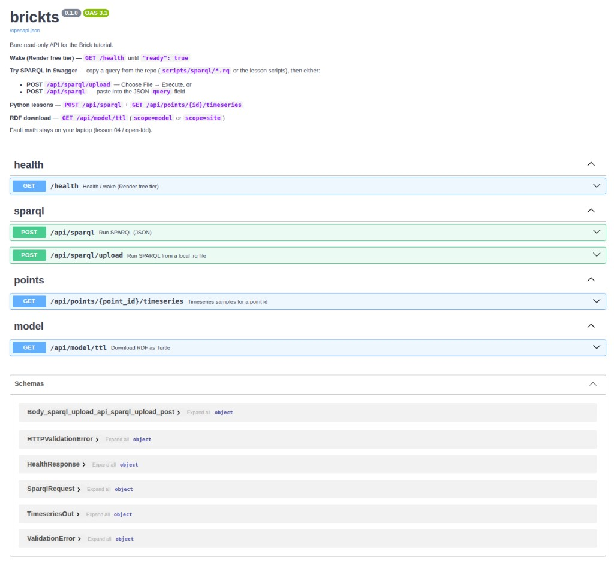

# brickts



A small tutorial API for **building data**:

1. A **Brick** model describes the site (AHUs, fans, sensors, zones…).
2. You ask questions with **SPARQL** (“which AHUs exist?”, “where is duct static pressure?”).
3. The model points at **timeseries ids** in a database — you never query by raw CSV column name.

This repo uses SQLite as a stand-in historian. A real site would use Timescale, Influx, or a data lake; the API shape stays the same.

**Demo site:** `BUILDING_50` with `AHU_1` and `AHU_2`.  
**Wake (after Render sleep):** <https://sparql-playground.onrender.com/health>  
**Live API docs:** <https://sparql-playground.onrender.com/docs>  
**SPARQL text files (in this repo):** [`scripts/sparql/`](scripts/sparql/) · [`docs/sparql_queries.md`](docs/sparql_queries.md)

Copy a `.rq` from the tutorial, wake with **GET** `/health`, then **POST** `/api/sparql/upload` (Choose File) or paste into **POST** `/api/sparql`.

Download the Brick graph as Turtle: **GET** `/api/model/ttl` (full building model) or `?scope=site` (site skeleton only). That request also writes repo-root **`building.ttl`** on a background thread — easy to open, commit, and push for tutorials.

Optional UI ([`web/`](web/)): model tag-tree + **in-browser SPARQL editor** + dashboard. Mutations need `BRICKTS_ALLOW_MUTATIONS=true`.

```
CSV history  ──bootstrap──▶  SQLite (long/narrow samples)
site.ttl + point maps  ──build──▶  Brick Turtle  ──▶  SPARQL API
Browser → /docs (Swagger)     Laptop → scripts/lesson_0*.py
Model UI → web/               Live export → ./building.ttl
```

Details for agents: [`AGENTS.md`](AGENTS.md). Locked choices: [`agent_spec/ARCHITECTURE.md`](agent_spec/ARCHITECTURE.md).

## Daily SQL / PostgreSQL / Timescale course

[**84 daily lessons and 12 weekly challenges**](lessons/sql/INDEX.md) take a complete beginner through SQL, schema design, safe queries, HVAC analytics and fault detection. Practical Brick/SPARQL lessons connect the data model to exact time-series identities. The final week studies actual Open-FDD SQL.

Use the [isolated local lab](lessons/sql/LAB_GUIDE.md) or [set up Timescale on a remote lab machine](lessons/sql/REMOTE_SETUP.md). This independent course database leaves the existing SQLite API tutorial intact.

## Run locally

```bash
uv sync
uv run brickts model build
uv run brickts bootstrap
uv run brickts serve          # http://127.0.0.1:8000/docs
```

## Tutorial scripts (no CLI args)

Edit `BASE_URL` (and friends) at the top of each `scripts/lesson_0*.py`, then:

```bash
uv run python scripts/lesson_01_mech_summary.py   # inventory via SPARQL
uv run python scripts/lesson_02_fc1_points.py      # find FC1 points
uv run python scripts/lesson_03_fc1_dataframe.py   # month → pandas DF
uv run python scripts/lesson_04_run_fc1.py           # run Open-FDD FC1 locally
```

## Docker

```bash
docker compose up --build
# Swagger: http://127.0.0.1:8000/docs
```

## License

See [LICENSE](LICENSE).
