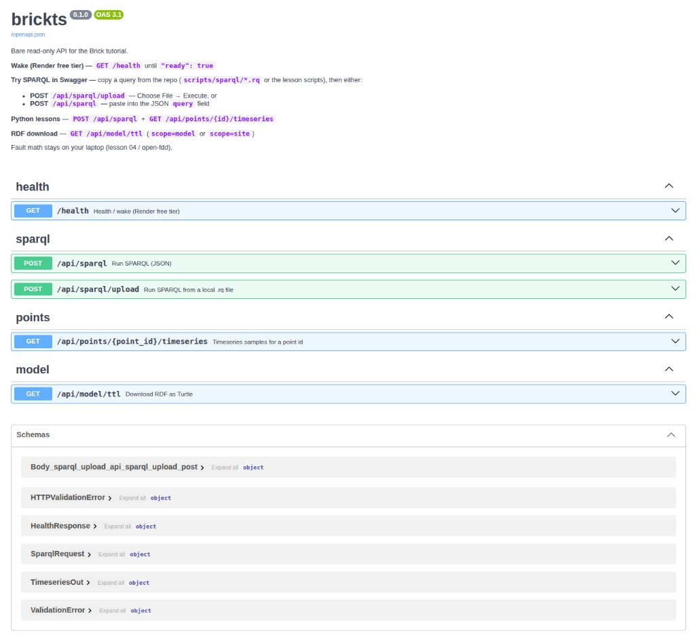

# brickts

A small tutorial API for **building data**:

1. A **Brick** model describes the site (AHUs, fans, sensors, zones…).
2. You ask questions with **SPARQL** (“which AHUs exist?”, “where is duct static pressure?”).
3. The model points at **timeseries ids** in a database — you never query by raw CSV column name.

This repo uses SQLite as a stand-in historian. A real site would use Timescale, Influx, or a data lake; the API shape stays the same.

**Demo site:** BUILDING_50 with AHU_1 and AHU_2.  
**Wake (after Render sleep):** <https://sparql-playground.onrender.com/health>  
**Live API docs (Swagger):** <https://sparql-playground.onrender.com/docs>  
**Example queries:** [scripts/sparql/](scripts/sparql/) · [docs/sparql_queries.md](docs/sparql_queries.md)

## Try it in Swagger

Open /docs, then:

1. **GET** /health — wake the server (retry until 
eady is true).
2. **POST** /api/sparql — the FC1 points example is prefilled; or paste a query from scripts/sparql/.
3. **POST** /api/sparql/upload — Choose File and run a local .rq.
4. **GET** /api/points/{id}/timeseries — samples for a point id returned by SPARQL (for example AHU_1_DA_P).
5. **GET** /api/model/ttl — download the Brick graph as Turtle (?scope=site for the site skeleton only).

`
CSV history  ──bootstrap──▶  SQLite (long/narrow samples)
site.ttl + point maps  ──build──▶  Brick Turtle  ──▶  SPARQL API
Browser → /docs (Swagger)     Laptop → scripts/lesson_0*.py
`

Details for agents: [AGENTS.md](AGENTS.md). Locked choices: [gent_spec/ARCHITECTURE.md](agent_spec/ARCHITECTURE.md).

## Run locally

`ash
uv sync
uv run brickts model build
uv run brickts bootstrap
uv run brickts serve          # http://127.0.0.1:8000/docs
`

## Tutorial scripts (no CLI args)

Edit BASE_URL (and friends) at the top of each scripts/lesson_0*.py, then:

`ash
uv run python scripts/lesson_01_mech_summary.py   # inventory via SPARQL
uv run python scripts/lesson_02_fc1_points.py      # find FC1 points
uv run python scripts/lesson_03_fc1_dataframe.py   # month → pandas DF
uv run python scripts/lesson_04_run_fc1.py           # run Open-FDD FC1 locally
`

## Docker

`ash
docker compose up --build
# Swagger: http://127.0.0.1:8000/docs
`

## License

See [LICENSE](LICENSE).
