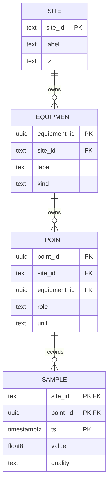

# The practice database at a glance

[Course index](INDEX.md) · [Exact fixture contract](CONTRACT.md) · [Glossary](GLOSSARY.md)

## Decide what one row means

| Table | One row means | Stable identity |
| --- | --- | --- |
| `course.site` | A synthetic building/site | `site_id` |
| `course.equipment` | One piece of equipment at a site | `equipment_id`, with site ownership |
| `course.point` | One measurement or command channel | `point_id`, with equipment/site ownership |
| `course.sample` | One observation of that point at an instant | `(site_id, point_id, ts)` |
| `course.lab_meta` | The course's schema version and ownership marker | One sentinel row |

`student` is your scratch schema. A schema is a namespace inside a database. It is not an independent server or security boundary by itself.

The actual SQL uses **composite foreign keys** to enforce the site's ownership all the way down. The diagram summarizes relationships; inspect `sql/00_schema.sql` for exact constraints. Reusing the label “Supply A” at two sites is intentional. A name is useful for people, but it cannot safely replace identity in a join.

## Two useful views

`course.history` joins metadata onto long observations. Its grain remains one point at one instant; do not sum fan status and fan command as if they were two motors.

`course.ahu_5m` pivots role values into one row per site/equipment/instant. Good-quality values become columns; absent or bad values remain null. It does not interpolate missing samples. The fixture has exactly one selected point for each role/equipment; multiple matching sensors in a real model need an explicit selection policy.

## Where the graph fits

The small Brick graph describes equipment, points, roles and units. A point follows `ref:hasExternalReference` to `ref:TimeseriesReference`. That reference provides its frozen `ref:hasTimeseriesId` and `ref:storedAt` database node. The opaque id equals the SQL `point_id` in this teaching fixture.

The database node stores a connection **environment variable name**, never a password. SPARQL finds the intended identity. SQL filters and aggregates its time-series samples. Neither layer should guess identity from an equipment label. The course validates that both copies of the metadata agree; it does not claim a live graph-to-database synchronization service.
